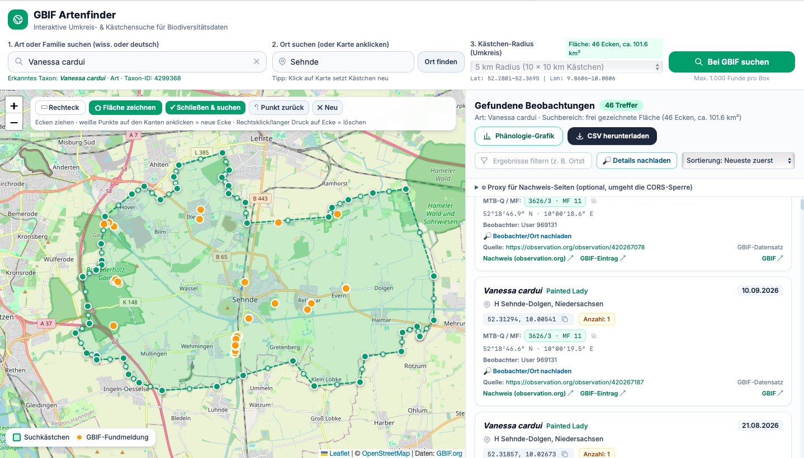
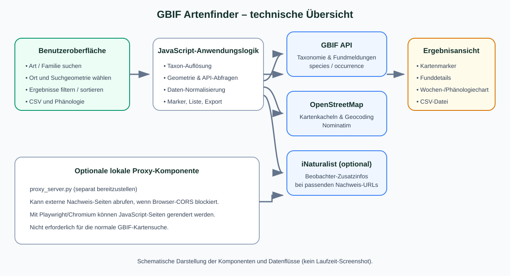

# GBIF Artenfinder

Interaktive Webanwendung zur räumlichen Recherche von Art- und Familiennachweisen aus der **GBIF-Datenbank**. Sie verbindet eine taxonomische Suche mit einer interaktiven Karte, frei definierbaren Suchgebieten, einer Ergebnisliste, Zusatzinformationen, einer Phänologie-Auswertung und CSV-Export.

> **Technische Einordnung:** Das Projekt ist kein eigenständiges HTML-Framework und keine wiederverwendbare UI-Bibliothek. Es ist eine in einer HTML-Datei gebündelte, clientseitige Webanwendung. Sie verwendet HTML, CSS, Vanilla JavaScript, Leaflet, Tailwind CSS und externe Web-APIs.

## Inhaltsverzeichnis

- [Überblick](#überblick)
- [Funktionsumfang](#funktionsumfang)
- [Bedienoberfläche](#bedienoberfläche)
- [Taxonomische Suche](#taxonomische-suche)
- [Orts- und Gebietssuche](#orts--und-gebietssuche)
- [Datenquellen und APIs](#datenquellen-und-apis)
- [Ergebnisdaten und Zusatzinformationen](#ergebnisdaten-und-zusatzinformationen)
- [Phänologie und CSV-Export](#phänologie-und-csv-export)
- [Technischer Aufbau](#technischer-aufbau)
- [Installation und Start](#installation-und-start)
- [Optionaler Proxy](#optionaler-proxy)
- [Grenzen und Hinweise](#grenzen-und-hinweise)
- [Datenschutz und Betrieb](#datenschutz-und-betrieb)
- [Mögliche Weiterentwicklung](#mögliche-weiterentwicklung)

## Überblick

Der GBIF Artenfinder hilft dabei, Vorkommensmeldungen eines Taxons in einem geografisch abgegrenzten Gebiet zu finden und räumlich auszuwerten. Gesucht werden können beispielsweise:

- wissenschaftliche Artnamen, z. B. `Vanessa cardui`,
- deutsche Trivialnamen, sofern in den verwendeten GBIF-Taxonomiedaten vorhanden,
- Familien und andere taxonomische Rangstufen, z. B. `Pieridae`,
- Gattungen und weitere unterstützte Taxa.

Ein Suchlauf ordnet den eingegebenen Namen möglichst einer GBIF-Taxon-ID zu. Danach werden Fundmeldungen mit Koordinaten aus dem gewählten Gebiet geladen. Die Funde erscheinen als Marker auf der Karte und als Datensätze in der Ergebnisliste.

Die HTML-Datei enthält voreingestellte Beispielwerte: **Vanessa cardui (Distelfalter)** und **Sehnde**. Das sind Startwerte und keine festen Einschränkungen.

## Funktionsumfang

1. **Taxon finden:** Namensvorschläge aus der GBIF-Taxonomie werden während der Eingabe geladen.
2. **Gebiet bestimmen:** Ein Ort wird über OpenStreetMap gesucht oder direkt auf der Karte ausgewählt.
3. **Suchfläche festlegen:** Rechteckiger Umkreis oder frei gezeichnetes Polygon.
4. **GBIF abfragen:** Abruf georeferenzierter Vorkommensmeldungen über die GBIF Occurrence API.
5. **Ergebnisse darstellen:** Fundmeldungen werden vereinheitlicht, als Kartenmarker und in einer Ergebnisliste gezeigt.
6. **Auswerten:** Filtern, Sortieren und Phänologie-Diagramm nach Kalenderwochen.
7. **Weiterverwenden:** CSV-Export und optionales Nachladen von Beobachter- und Ortsdetails.

## Bedienoberfläche

Die Oberfläche gliedert sich in eine obere Suchleiste und einen zweigeteilten Arbeitsbereich: links die Karte, rechts die Ergebnisliste mit Auswertungs- und Exportfunktionen.



*Die Abbildung ist eine eigens erstellte schematische Darstellung der Bedienelemente, kein Screenshot der laufenden Anwendung.*

### Suchleiste

- **Art oder Familie suchen:** wissenschaftlicher Name oder deutscher Name; Vorschläge erscheinen während der Eingabe.
- **Ort suchen:** Ortsname, Postleitzahl oder Region; alternativ kann die Karte angeklickt werden.
- **Kästchen-Radius:** 1, 2, 5, 10 oder 20 km. Daraus entsteht zunächst ein Quadrat mit doppelter Kantenlänge: 5 km Radius entsprechen ungefähr 10 × 10 km.
- **Bei GBIF suchen:** startet die Abfrage mit den aktuellen Parametern.

### Kartenbereich

- Leaflet-Karte mit Zoom- und Verschiebefunktion.
- Suchgebiet als grün umrandete Fläche.
- Fundmeldungen als orangefarbene Marker.
- Umschaltung zwischen Rechteck und frei gezeichneter Fläche.
- Klick auf einen Fundmarker öffnet ein Informationsfenster.

### Ergebnisbereich

- Trefferzahl und Zusammenfassung des Suchlaufs.
- Textfilter für geladene Ergebnisse.
- Sortierung nach Datum (neueste/älteste), Fundort oder Datenquelle.
- Funktion zum Nachladen von Beobachter- und Ortsdetails.
- Phänologie-Grafik und CSV-Download.

## Taxonomische Suche

Die Anwendung kombiniert mehrere GBIF-Endpunkte:

- `species/suggest` für Namensvorschläge,
- `species/search` für die Suche nach deutschen Trivialnamen im verwendeten deutschen Namensdatensatz,
- `species/match` zur Zuordnung eines Namens zu einem Taxon und als Fallback bei Freitext.

Vorschläge zeigen – soweit verfügbar – wissenschaftlichen Namen, deutschen Namen, Rangstufe und Taxon-ID. Ähnliche oder unscharfe Treffer werden gekennzeichnet. Bei Auswahl einer höheren Rangstufe wie einer Familie umfasst die Suche die darunterliegenden Taxa entsprechend der GBIF-Taxonomie.

## Orts- und Gebietssuche

### Ortsauflösung

Die Ortsauflösung verwendet **Nominatim**, den Geocoding-Dienst von OpenStreetMap. Nach erfolgreicher Suche wird die Karte auf den Ort zentriert und das Suchgebiet in der gewählten Größe erstellt.

Ein Klick auf die Karte setzt den Mittelpunkt des Suchrechtecks neu. Eine Änderung der Radiusauswahl passt die Abmessungen um den aktuellen Mittelpunkt an.

### Rechtecksuche

Im Rechteckmodus kann die Fläche interaktiv angepasst werden:

- Vier Eckgriffe verändern Breite und Höhe.
- Der Griff in der Mitte verschiebt das gesamte Rechteck.
- Nach dem Loslassen eines Griffs wird die Suche automatisch erneut ausgeführt.
- Bei einer manuell veränderten Fläche wechselt die Radiusanzeige auf „Individuell gezogen“.

Die Anwendung zeigt die geografischen Grenzen als Breiten- und Längengrade sowie die ungefähren Abmessungen in Kilometern an.

### Freie Flächensuche (Polygon)

Im Polygonmodus wird die Suchfläche durch Klicks auf die Karte aufgebaut:

- Mindestens drei Eckpunkte sind erforderlich.
- **Schließen & suchen** beendet die Zeichnung und startet die Abfrage.
- **Punkt zurück** nimmt den letzten Punkt zurück bzw. öffnet eine geschlossene Fläche wieder.
- **Neu** löscht die aktuelle Zeichnung.
- Eckpunkte können verschoben werden.
- Ein Klick auf einen weißen Zwischenpunkt einer Kante fügt dort eine zusätzliche Ecke ein.
- Rechtsklick bzw. Kontextmenü auf einen Eckpunkt löscht ihn; eine geschlossene Fläche behält mindestens drei Ecken.

Vor dem Senden wird geprüft, ob sich Polygonkanten überschneiden. Für GBIF wird die Fläche als WKT-`POLYGON` übergeben. Der äußere Ring wird in der von GBIF erwarteten Orientierung aufgebaut. Zusätzlich prüft die Anwendung Fundkoordinaten lokal auf Zugehörigkeit zum Polygon.

## Karte und Geometrien

Die Kartendarstellung basiert auf **Leaflet 1.9.4**. Als Kartenhintergrund werden Kacheln von OpenStreetMap verwendet. Suchfläche und Fundmarker liegen in getrennten Leaflet-Layer-Gruppen und können unabhängig voneinander aktualisiert werden.



*Die Abbildung zeigt die logische Architektur und die externen Datenverbindungen.*

## Datenquellen und APIs

| Dienst / Bibliothek | Aufgabe |
|---|---|
| **GBIF Species API** | Taxonomische Namensvorschläge, Namenssuche und Taxon-Auflösung |
| **GBIF Occurrence API** | Abruf georeferenzierter Fundmeldungen |
| **GBIF Verbatim API** | Originalfelder eines Funddatensatzes beim Nachladen von Details |
| **OpenStreetMap-Kartenkacheln** | Kartengrundlage |
| **Nominatim** | Orts-Suche und Reverse-Geocoding |
| **iNaturalist API** | Ergänzende Beobachter-/Ortsangaben bei passenden iNaturalist-Nachweis-URLs |
| **Leaflet 1.9.4** | Interaktive Karte, Layer, Rechtecke, Polygone und Marker |
| **Tailwind CSS (CDN)** | Layout und Gestaltung |
| **Google Fonts – Inter** | Schriftart |

Die Fundabfrage verwendet `https://api.gbif.org/v1/occurrence/search`. Es werden nur Datensätze mit Koordinaten angefordert (`hasCoordinate=true`).

### Abrufmenge

Der Code lädt Fundmeldungen in Seiten zu je 300 Datensätzen und begrenzt den Abruf auf **maximal 1.000 Datensätze pro Suchlauf**. Gibt es mehr Treffer, zeigt die Anwendung die Zahl der geladenen Datensätze im Verhältnis zur von GBIF gemeldeten Trefferzahl an. Die Liste ist dann nicht vollständig.

## Ergebnisdaten und Zusatzinformationen

Die Funktion `normalizeOccurrence()` überführt GBIF-Rohdaten in ein einheitliches internes Format. Dieses Format wird für Karte, Ergebnisliste, Popups, Phänologie und CSV verwendet.

Je nach Verfügbarkeit können enthalten sein:

- wissenschaftlicher und deutscher Name,
- Datum bzw. Jahr, Monat und Tag,
- Fundort, Gemeinde, Landkreis und Bundesland,
- Koordinaten in Dezimalgrad und Grad-Minuten-Sekunden,
- MTB-/Quadranten-/Minutenfeld-Angaben, die aus den Koordinaten berechnet werden,
- Koordinatenunsicherheit,
- Beobachter bzw. Melder, sofern in den Daten vorhanden,
- Anzahl der Individuen, Geschlecht und Lebensstadium,
- Datenquelle, Datensatzname, Institution und Lizenz,
- GBIF-Datensatz-ID und Link zum GBIF-Eintrag,
- Nachweis-Link und – sofern vorhanden – Bild-URL.

### Fundmarker und Popups

Jeder Fund mit gültigen Koordinaten wird als Marker auf der Karte angezeigt. Das Popup kann Artname, Funddatum, Fundort, Koordinaten, Rasterangaben, Beobachter, Datenquelle, Belegbild und Links enthalten. Koordinaten und MTB-Kennung lassen sich aus dem Popup in die Zwischenablage kopieren.

### Details nachladen

Die Detailanreicherung ist optional, da sie zusätzliche Netzwerkabfragen auslöst. Für einen Fund versucht die Anwendung Informationen aus folgenden Quellen zu ergänzen:

1. GBIF-Verbatim-Felder,
2. iNaturalist API, wenn der Nachweis-Link auf eine iNaturalist-Beobachtung verweist,
3. die Original-Nachweis-Seite, sofern sie direkt oder über den Proxy lesbar ist,
4. Nominatim-Reverse-Geocoding anhand der Fundkoordinaten.

Die Schaltfläche **Details nachladen** ergänzt die aktuell gefilterten Funde, allerdings höchstens 50 pro Sammellauf. Einzelne Datensätze können ebenfalls separat angereichert werden. Quellen werden in der Oberfläche kenntlich gemacht; zusätzliche Angaben sind nicht garantiert.

## Phänologie und CSV-Export

### Phänologie

Die optionale Phänologie-Grafik stellt die Anzahl der Funde je ISO-Kalenderwoche dar. Alle geladenen Jahre werden zusammengefasst.

Soweit GBIF-Datensätze ein Lebensstadium enthalten, werden die Funde nach Stadien klassifiziert und als gestapelte Balken visualisiert. Über die Legende können einzelne Stadien ein- oder ausgeblendet werden.

Die Grafik zeigt die zeitliche Verteilung der in den geladenen GBIF-Daten enthaltenen Meldungen. Sie ist keine standardisierte Populationszählung. Beobachtungsaufwand, Datenabdeckung und Meldeverhalten beeinflussen die Werte.

### CSV-Export

Über **CSV herunterladen** werden die geladenen Funddatensätze exportiert. Der Export ist für Tabellenkalkulationen, GIS-Programme oder Statistiksoftware gedacht.

Der Export bezieht sich auf die im aktuellen Suchlauf geladenen Datensätze (bis zur Grenze von 1.000). Der Textfilter und die Sortierung dienen der Darstellung der Liste; der Export greift auf `state.allOccurrences` zu und exportiert damit den geladenen Gesamtdatensatz des Suchlaufs.

## Technischer Aufbau

### Technologien

| Technologie | Verwendung |
|---|---|
| HTML5 | Seitenstruktur und Bedienelemente |
| CSS | projektspezifische Karten-, Marker- und Popup-Anpassungen |
| JavaScript (Vanilla JS) | Anwendungszustand, Ereignisse, API-Aufrufe und Darstellung |
| Tailwind CSS via CDN | Utility-Klassen für Layout und Design |
| Leaflet.js 1.9.4 | interaktive Kartenlogik |
| SVG | Icons und Diagrammvisualisierung |
| Fetch API | HTTP-Anfragen an externe Dienste |
| Local Storage | Speicherung der optionalen Proxy-Einstellungen |

### Architektur

Das Projekt ist als einzelne HTML-Datei aufgebaut. CSS und JavaScript sind direkt in `GBIFArtenfinder.html` eingebettet. In der vorliegenden Datei sind keine Build-Pipeline, kein Paketmanifest und kein Frontend-Framework wie React, Vue oder Angular erkennbar.

Zentrale Bestandteile:

- **`state`:** zentraler Anwendungszustand (Kartenmittelpunkt, Radius, Suchgrenzen, Taxon, Funddaten und Geometriemodus).
- **Karteninitialisierung:** Leaflet-Karte, OpenStreetMap-Kacheln und Layer-Gruppen.
- **Bounding-Box-Funktionen:** Berechnung, Darstellung und Bearbeitung des Rechtecks.
- **Polygon-Funktionen:** Zeichnen, Schließen, Validieren und Umwandeln in WKT.
- **Taxon-Suche:** Vorschläge und Taxon-Matching über GBIF.
- **`fetchGbifOccurrences()`:** Abruf der Fundmeldungen.
- **`normalizeOccurrence()`:** Aufbereitung der GBIF-Rohdaten.
- **Rendering-Funktionen:** Marker, Popups, Ergebnisliste und Diagramm.
- **Detailanreicherung:** zusätzliche Informationen aus GBIF, iNaturalist, Nachweis-Seiten und OSM.
- **CSV-Export:** Ausgabe der geladenen Datensätze.

### Was ist hier Framework, Bibliothek und Anwendung?

- **HTML** beschreibt die Struktur der Seite.
- **Tailwind CSS** ist eine CSS-Utility-Bibliothek, kein HTML-Framework.
- **Leaflet** ist eine JavaScript-Bibliothek für interaktive Karten.
- **GBIF und OpenStreetMap/Nominatim** sind externe Daten- bzw. Webdienste.
- **Der GBIF Artenfinder** ist die konkrete Anwendung, die diese Bausteine zusammenführt.

## Installation und Start

### Voraussetzungen

- Aktueller Browser (Firefox, Chrome, Edge oder Safari).
- Internetverbindung, da Kartenkacheln, Schriftarten und API-Daten von externen Diensten geladen werden.
- Für die normale Suche ist kein eigener Server und keine Datenbank erforderlich.

### Schnellstart

1. `GBIFArtenfinder.html` lokal speichern.
2. Datei im Browser öffnen.
3. Eine Art oder Familie eingeben und einen Vorschlag auswählen (oder den Namen per Enter übernehmen).
4. Einen Ort suchen oder das Suchgebiet auf der Karte setzen.
5. Radius bzw. Polygonfläche festlegen.
6. **Bei GBIF suchen** ausführen.

Je nach Browser- und Sicherheitskonfiguration kann ein lokaler HTTP-Server zuverlässiger sein als `file://`.

### Optionaler lokaler HTTP-Server

Im Verzeichnis der HTML-Datei:

```bash
python -m http.server 8000
```

Dann im Browser öffnen:

```text
http://localhost:8000/GBIFArtenfinder.html
```

## Optionaler Proxy

Der Proxy ist **nicht** für die normale GBIF-Artsuche erforderlich. Er wird nur benötigt, wenn externe Original-Nachweis-Seiten wegen Browser-CORS-Regeln nicht direkt ausgelesen werden können.

Die HTML-Oberfläche erwartet standardmäßig einen lokalen Dienst unter `http://127.0.0.1:8787`. Die Proxy-Steuerung bietet:

- Aktivieren/Deaktivieren,
- Anpassung der Proxy-URL,
- optionales Rendern der Zielseite in einem Headless-Browser,
- Verbindungstest über `/health`.

Die HTML-Datei nennt folgende Startschritte:

```bash
pip install playwright
python -m playwright install chromium
python proxy_server.py
```

**Wichtig:** `proxy_server.py` ist eine separate Komponente und liegt der hier dokumentierten HTML-Datei nicht bei. Die README beschreibt daher nur die von der HTML-Datei erwartete Schnittstelle und die im UI angezeigten Startschritte. Sie bestätigt nicht, dass ein passender Proxy-Server bereits vorhanden oder produktionssicher implementiert ist.

## Grenzen und Hinweise

- **Maximal 1.000 Funde je Suchlauf:** weitere GBIF-Treffer werden in dieser Version nicht vollständig geladen.
- **Nur georeferenzierte Datensätze:** Meldungen ohne Koordinaten bleiben durch `hasCoordinate=true` unberücksichtigt.
- **Datenqualität:** GBIF-Daten stammen von vielen Datenlieferanten. Namen, Ortsangaben, Datumswerte, Koordinaten und Beobachterinformationen können unvollständig oder fehlerhaft sein.
- **Koordinatenunschärfe:** die angegebene Unsicherheit kann die Interpretation feiner Rasterangaben beeinflussen.
- **Polygon-Geometrie:** sehr komplexe oder von GBIF abgelehnte Polygone können zu einem API-Fehler führen.
- **Externe Verfügbarkeit:** GBIF, Nominatim, OpenStreetMap-Kacheln und iNaturalist sind externe Dienste. Störungen, Limits und Änderungen liegen außerhalb der Anwendung.
- **CORS:** Browser dürfen externe Webseiten nicht beliebig auslesen. Das Nachladen von Nachweis-Seiten kann daher ohne Proxy scheitern.
- **Phänologie ist meldeabhängig:** die Zahl der Meldungen hängt auch vom Beobachtungs- und Meldeaufwand ab.
- **Keine zentrale Datenbank:** die Suchergebnisse werden zur Laufzeit im Browser gehalten; eine dauerhafte zentrale Speicherung ist in der HTML-Datei nicht implementiert.

## Datenschutz und Betrieb

Suchanfragen werden direkt vom Browser an die eingebundenen externen Dienste gesendet. Die HTML-Datei enthält keine eigene Benutzerverwaltung und keinen eigenen Backend-Datenspeicher.

Beim Betrieb sind die Nutzungsbedingungen und Richtlinien der Dienste zu beachten, insbesondere für GBIF, OpenStreetMap-Kartenkacheln und Nominatim. Reverse-Geocoding-Anfragen werden im Code zeitlich serialisiert, um die Nominatim-Dienstvorgabe von ungefähr einer Anfrage pro Sekunde zu berücksichtigen.

## Mögliche Weiterentwicklung

Folgende Punkte wären mögliche Erweiterungen und sind **nicht** als bereits implementiert zu verstehen:

- Aufteilung in getrennte HTML-, CSS- und JavaScript-Dateien,
- Konfigurationsdatei für API-Endpunkte und Abrufgrenzen,
- Pagination oder serverseitige Verarbeitung für mehr als 1.000 Funde,
- automatisierte Tests für Taxon-Auflösung, Polygonprüfung und Daten-Normalisierung,
- robustere Fehler- und Rate-Limit-Behandlung,
- reproduzierbare Exporte mit Suchparametern und Abrufdatum,
- optionale Speicherung von Suchprofilen,
- barriereärmere Tastaturbedienung und zusätzliche UI-Tests.

## Lizenz- und Quellenhinweise

Die Anwendung verwendet externe Bibliotheken und Datenquellen. Bitte beachte deren jeweilige Lizenz-, Zitier- und Nutzungsbedingungen:

- [GBIF](https://www.gbif.org/)
- [GBIF API-Dokumentation](https://techdocs.gbif.org/en/openapi/)
- [OpenStreetMap](https://www.openstreetmap.org/copyright)
- [Nominatim Usage Policy](https://operations.osmfoundation.org/policies/nominatim/)
- [Leaflet](https://leafletjs.com/)
- [Tailwind CSS](https://tailwindcss.com/)

Die konkrete Lizenz des Projekts selbst ist aus der vorliegenden HTML-Datei nicht ersichtlich und sollte vom Projektverantwortlichen ergänzt werden.
